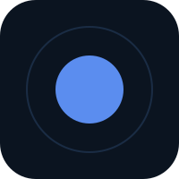
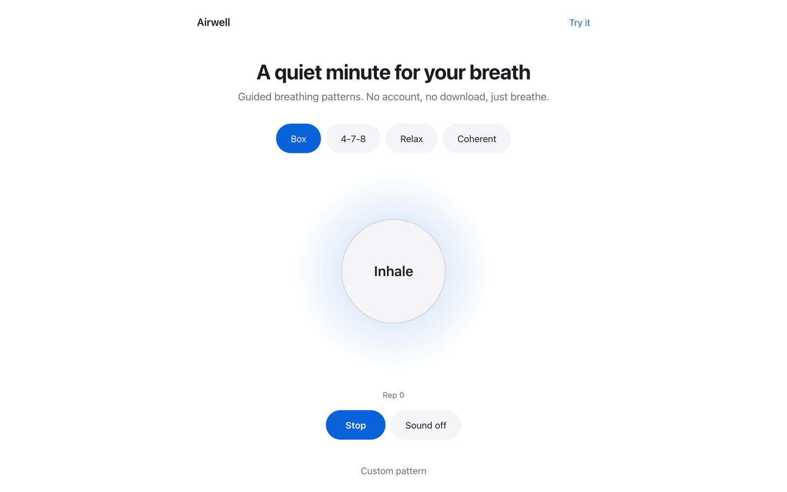
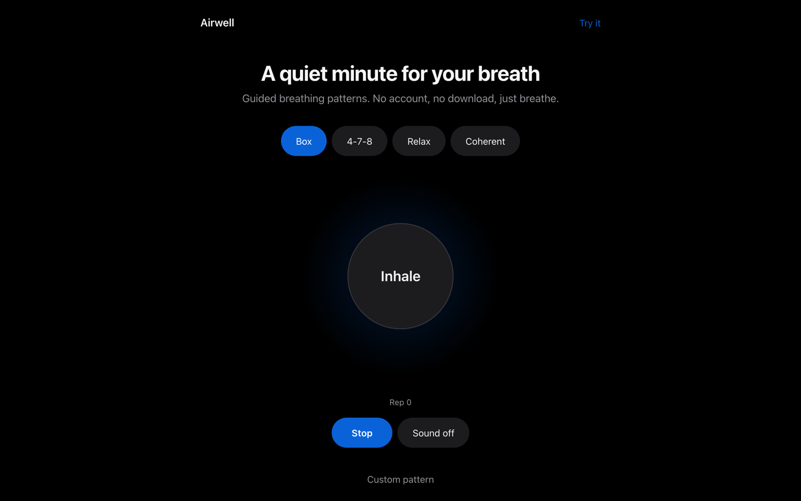
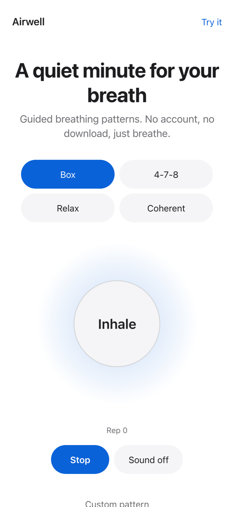
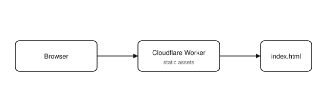

 

A quiet minute for your breath.

Four guided breathing patterns, a circle that expands and contracts on your behalf, and nothing else. No account, no download, no timer running out on you.

**[airwell.jaybulb.com →](https://airwell.jaybulb.com)**


## Screenshots

<p>



</p>

## Features

- **Four patterns, plus your own.** Box (4-4-4-4), 4-7-8, Relax, Coherent, or build one. The circle does the counting.
- **Feel it.** A soft tap at each change of breath, so you can close your eyes.
- **Streaks and a reminder.** History, a day streak, and one daily nudge if you want it.
- **Your colours.** Five themes, or pick your own. Text adjusts itself so it stays readable.
- **11 languages.** English, Spanish, French, German, Italian, Portuguese, Japanese, Korean, Chinese (Simplified and Traditional), Russian and Arabic.
- **Accessible.** VoiceOver, Dynamic Type and Reduce Motion all work.
- **Private.** No account, no ads, nothing leaves the device.

## Platforms

| | |
|---|---|
| Web | This repo, deployed to Cloudflare Workers |
| iOS, macOS | `ios/`, native SwiftUI, xcodegen |

## Running locally

```bash
npx wrangler dev
```

## Deploying

```bash
npx wrangler deploy
```

## Architecture


