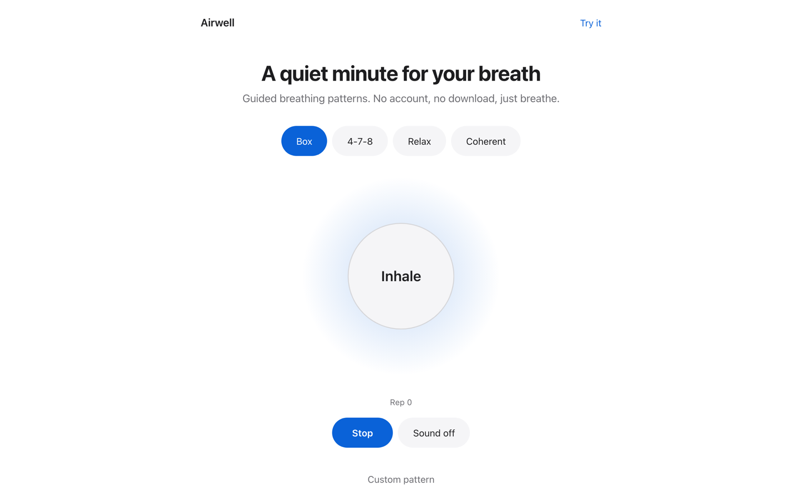
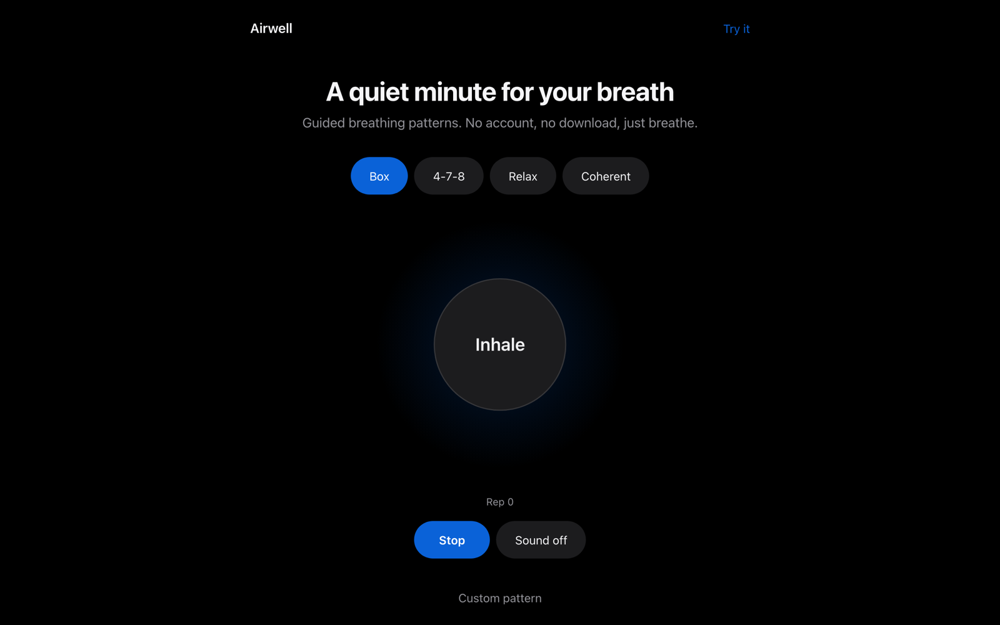
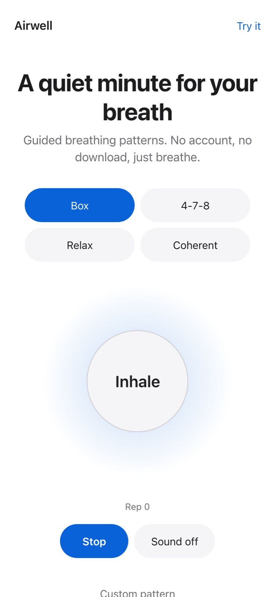

# Airwell

  [](https://github.com/nulljosh/airwell)

A quiet minute for your breath.

Four guided breathing patterns, a circle that expands and contracts on your behalf, and nothing else. No account, no download, no timer running out on you.

**[airwell.jaybulb.com →](https://airwell.jaybulb.com)**


## Screenshots

<p>



</p>

## Features

- **Four patterns.** Box (4-4-4-4), 4-7-8, Relax, Coherent. Pick one, the circle does the counting.
- **One screen.** No settings, no sign-up, no ads.
- **Light and dark.** Follows your system theme.

## Platforms

| | |
|---|---|
| Web | This repo, deployed to Cloudflare Workers |
| iOS, macOS | `ios/`, xcodegen, WKWebView wrapper |

## Running locally

```bash
npx wrangler dev
```

## Deploying

```bash
npx wrangler deploy
```

## Architecture


