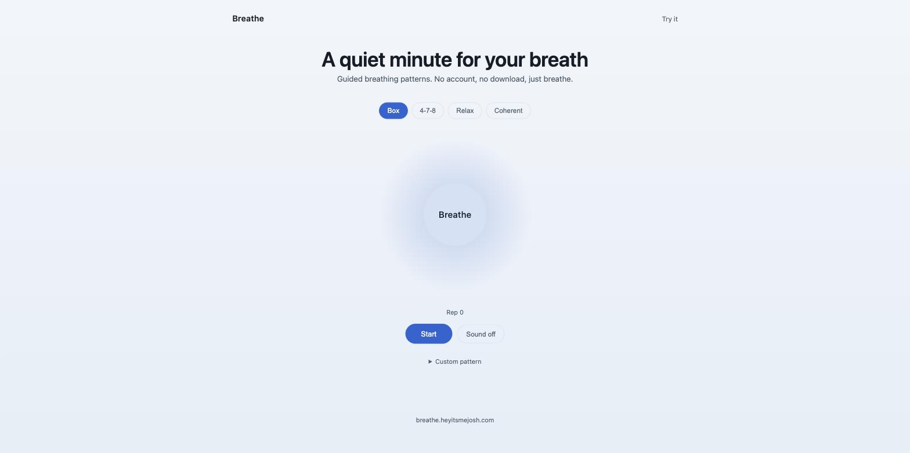
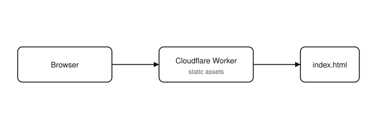

# Breathe

  [](https://github.com/nulljosh/breathe)

A quiet minute for your breath.

Four guided breathing patterns, a circle that expands and contracts on your behalf, and nothing else. No account, no download, no timer running out on you.

**[breathe.heyitsmejosh.com →](https://breathe.heyitsmejosh.com)**

## Screenshots

<p>

</p>

## Features

- **Four patterns.** Box (4-4-4-4), 4-7-8, Relax, Coherent. Pick one, the circle does the counting.
- **One screen.** No settings, no sign-up, no ads.
- **Light and dark.** Follows your system theme.

## Platforms

| | |
|---|---|
| Web | This repo, deployed to Cloudflare Workers |

Native (iOS, macOS, Android, desktop) is on the [roadmap](roadmap.md), not built yet.

## Running locally

```bash
npx wrangler dev
```

## Deploying

```bash
npx wrangler deploy
```

## Architecture


